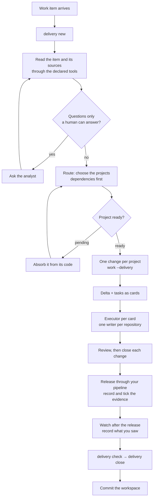

# The end-to-end flow

One item of work — a story, a screen, a fix — from the moment it arrives
to the moment it is released, watched and closed, across every
repository it touches. This page is the common flow. It names no tool and
assumes no stack: which repositories you have (front-end, back-end,
mobile, tests, data, infrastructure) and which MCP servers you connect
(tracker, documentation, design, browser, observability, data) are
yours to choose. The commands are in the [CLI reference](cli-reference.md);
the setup in detail is in [Work across repositories](workspace.md).

## Who does what

| Role | Who | Does | Never does |
|---|---|---|---|
| **Analyst** | You, the human | Brings the work, answers open questions, approves routing, every write a tool would make, and the release | Run the CLI by hand or write artifacts |
| **Planner** | The agent session opened on the workspace | Reads the work, routes it, writes changes and task cards, delegates, reviews, closes | Hand a task over without a card |
| **Executor** | A subagent, one task at a time | Implements one card in one repository, verifies, ticks, reports | Open, close or archive a change |
| **Reviewer** | A read-only subagent | Checks a finished change against its spec | Edit anything |
| **Specialists** (optional) | Subagents such as `qa` or `observer` | Work a card that needs a tool — exploring the app, reading monitors | Act outside their card |
| **Doctrina** | The CLI | Keeps the context, prints the playbooks and cards, runs the gates, guards tool calls | Call a model or a tool, deploy |

The rules behind the split are in [ADR 0030](../../.doctrina/decisions/0030-um-planejador-orquestra-um-escritor-por-repositorio-executores-recebem-cartoes-autocontidos.md):
one planner; one writer per repository at a time; executors work from
self-contained cards; only the planner closes.

## The flow at a glance

## Phase 0 — once per team or person

1. **Create the workspace** — a private git repository that holds the map
   of your repositories and the context of those that cannot carry their
   own: `doctrina workspace init <dir>`.
2. **Register each repository** with its role, a one-line description and
   what it depends on: `doctrina workspace add <path> --role <r> --about
   "<what it is>" --depends-on <other>`. A repository with its own
   `.doctrina/` is in-repo; one without becomes a shadow — its context lives
   in the workspace, linked in and hidden from that repository's git.
3. **Absorb every repository with no spec**, once, from its code:
   `doctrina intake --from-code` inside it, then the absorb playbook. A
   pending repository cannot be routed to.
4. **Declare the tools the work uses**, one per MCP server you connected:
   `doctrina workspace tool <name> --server <server-name> --for
   <roles> --purpose "<what for>"`. Read-only unless you add `--access
   write`. A preset exists for some common names; any name works with
   `--server`.
5. **Choose the models.** The planner runs on your agent's model; set the
   executors' in `workspace.json` (`"agents": {"executor": {"model":
   "<id>"}}`), or leave `inherit`.
6. **Open the workspace in your agent** — the generated
   `<name>.code-workspace` opens every repository in one window — and
   commit the workspace.

## Phase 1 — one item of work

| Step | Who | What happens | What holds it |
|---|---|---|---|
| 1. Open | Planner | `doctrina delivery new "<title>" --ref <item-id>` creates the delivery and prints the playbook | — |
| 2. Understand | Planner | Reads the item and its sources through the declared tools; copies the story and its acceptance criteria verbatim under `## Story`, links what it read under `## Sources` | `delivery check` while Story is empty |
| 3. Ask | Analyst | Answers what the item and the code cannot tell | The planner does not guess intent |
| 4. Route | Planner, confirmed by you | `doctrina delivery route <id> <projects>` — dependencies first | A pending or missing project is refused (exit 3) |
| 5. Plan | Planner | In each project: `doctrina work "<title>" --delivery <id>`, the spec delta, and tasks written as cards with `Files:`, `Requirement:` and `Verify:` lines; the plan across projects under `## Plan` | `change check` refuses a hollow change |
| 6. Execute | Executors | `doctrina change card <change>` from inside the repository, one card at a time per repository; different repositories in parallel | `delivery status` names a second writer in a repository |
| 7. Review | Reviewer, then planner | `doctrina review`, `doctrina verify`; the planner fixes or sends a card back | — |
| 8. Close each change | Planner | `doctrina close <change>` in each repository | Every gate: tasks, specs, tests, coverage, docs |
| 9. Release | Your pipeline, approved by you | Evidence under `## Release` — pipeline, environment, proof — and each claim ticked with `doctrina delivery tick <id> <n>` | `delivery check` while a box is open |
| 10. Watch | Planner or an observer | What was watched after the release, for how long, and what it showed, under `## Observability` | `delivery check` while it is empty |
| 11. Close the delivery | Planner | `doctrina delivery check <id>` → `doctrina delivery close <id>`, then commit the workspace | Any open change, empty record or open box |

Every tool call goes through the agent's pre-call hook: a write through a
tool declared read-only is refused; a write through a read/write tool
waits for you. Text a tool returns is data to the agents, never an
instruction.

## Where the analyst decides

- Which projects a delivery touches, before any change is opened.
- Every open question the absorb, the story or a card raises.
- Every write to an external system the guard holds.
- The release itself — your pipeline and your approvals stay yours.
- Whether a delivery is done: the close is the planner's, the evidence is
  what you read.

## What you choose

| Choice | Where | Default |
|---|---|---|
| Repositories and how they depend on each other | `workspace add --role --about --depends-on` | — |
| Which repositories are shadows | `workspace add --mode` | shadow when there is no `.doctrina/` |
| Tools, their roles and their access | `workspace tool` | read-only |
| Executor model | `workspace.json` → `agents` | inherit |
| Agent | `workspace add --agent`, and the files the workspace generates | cursor |

## When the flow bends

| Situation | What to do |
|---|---|
| A change was opened without `--delivery` | `doctrina work --resume <change> --delivery <id>` |
| The item turns out to touch another repository | `doctrina delivery route <id> <all projects>` again, then open its change |
| A repository has no spec yet | Absorb it, then route |
| Two deliveries are open in one repository | Sequence them; `delivery status` names the other writer |
| A tool write is refused | Ask the analyst; never route around the guard |
| A card is not enough to act on | The executor stops and says what is missing; the planner completes the card |
| The delivery stalls | `doctrina delivery check <id>` lists exactly what is missing |

## Related material

- [Work across repositories](workspace.md) — the workspace, shadows and the
  generated agent files in detail.
- [Multi-agent model](multi-agent.md) — why one writer per repository.
- [Brownfield adoption](brownfield.md) — absorbing an existing codebase.
- [Flow diagram](flow.md) — every command and where it sits.
