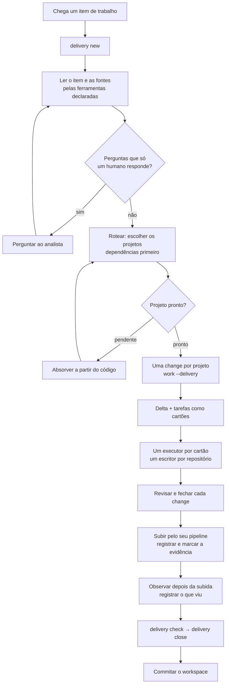

# O fluxo de ponta a ponta

> Tradução da [versão em inglês](../en/end-to-end-flow.md). O inglês é a
> fonte de verdade; este arquivo o segue.

Um item de trabalho — uma história, uma tela, uma correção — do momento em
que chega até ser publicado, observado e fechado, em todos os repositórios
que ele toca. Esta página é o fluxo comum. Ela não nomeia ferramenta nem
supõe stack: quais repositórios você tem (front-end, back-end, mobile,
testes, dados, infraestrutura) e quais servidores MCP você conecta
(rastreador, documentação, design, navegador, observabilidade, dados) são
escolha sua. Os comandos estão na [referência do CLI](cli-reference.md); a
preparação em detalhe está em [Trabalho entre repositórios](workspace.md).

## Quem faz o quê

| Papel | Quem | Faz | Nunca faz |
|---|---|---|---|
| **Analista** | Você, o humano | Traz o trabalho, responde as perguntas abertas, aprova o roteamento, toda escrita que uma ferramenta faria e a subida | Rodar o CLI à mão ou escrever artefatos |
| **Planejador** | A sessão do agente aberta no workspace | Lê o trabalho, roteia, escreve as changes e os cartões, delega, revisa, fecha | Entregar uma tarefa sem cartão |
| **Executor** | Um subagente, uma tarefa por vez | Implementa um cartão num repositório, verifica, marca, reporta | Abrir, fechar ou arquivar uma change |
| **Revisor** | Um subagente só de leitura | Confere uma change pronta contra a spec | Editar qualquer coisa |
| **Especialistas** (opcional) | Subagentes como `qa` ou `observer` | Trabalham um cartão que precisa de uma ferramenta — explorar a aplicação, ler monitores | Agir fora do cartão |
| **Doctrina** | O CLI | Guarda o contexto, imprime os playbooks e os cartões, roda os gates, guarda as chamadas de ferramenta | Chamar um modelo ou uma ferramenta, fazer deploy |

As regras por trás da divisão estão no [ADR 0030](../../.doctrina/decisions/0030-um-planejador-orquestra-um-escritor-por-repositorio-executores-recebem-cartoes-autocontidos.md):
um planejador; um escritor por repositório de cada vez; executores
trabalham a partir de cartões autocontidos; só o planejador fecha.

## O fluxo num relance

## Fase 0 — uma vez por time ou pessoa

1. **Crie o workspace** — um repositório git privado que guarda o mapa dos
   seus repositórios e o contexto dos que não podem carregar o próprio:
   `doctrina workspace init <dir>`.
2. **Registre cada repositório** com o papel, uma linha sobre o que ele é e
   de quem depende: `doctrina workspace add <caminho> --role <r> --about
   "<o que é>" --depends-on <outro>`. Um repositório com `.doctrina/`
   próprio é in-repo; um sem vira sombra — o contexto mora no workspace,
   ligado nele e escondido do git dele.
3. **Absorva cada repositório sem spec**, uma vez, a partir do código:
   `doctrina intake --from-code` dentro dele, e o playbook de absorção. Um
   repositório pendente não pode ser roteado.
4. **Declare as ferramentas que o trabalho usa**, uma por servidor MCP que
   você conectou: `doctrina workspace tool <nome> --server <nome-do-servidor>
   --for <papéis> --purpose "<para quê>"`. Só leitura, a menos que você
   acrescente `--access write`. Há presets para alguns nomes comuns;
   qualquer nome funciona com `--server`.
5. **Escolha os modelos.** O planejador roda no modelo do seu agente; o dos
   executores fica no `workspace.json` (`"agents": {"executor": {"model":
   "<id>"}}`), ou `inherit`.
6. **Abra o workspace no seu agente** — o `<nome>.code-workspace` gerado
   abre todos os repositórios numa janela — e commite o workspace.

## Fase 1 — um item de trabalho

| Passo | Quem | O que acontece | O que segura |
|---|---|---|---|
| 1. Abrir | Planejador | `doctrina delivery new "<título>" --ref <id-do-item>` cria a entrega e imprime o playbook | — |
| 2. Entender | Planejador | Lê o item e as fontes pelas ferramentas declaradas; copia a história e os critérios de aceite literalmente em `## Story` e linka o que leu em `## Sources` | `delivery check` enquanto a Story está vazia |
| 3. Perguntar | Analista | Responde o que o item e o código não dizem | O planejador não adivinha intenção |
| 4. Rotear | Planejador, você confirma | `doctrina delivery route <id> <projetos>` — dependências primeiro | Projeto pendente ou ausente é recusado (saída 3) |
| 5. Planejar | Planejador | Em cada projeto: `doctrina work "<título>" --delivery <id>`, o delta da spec e as tarefas escritas como cartões com as linhas `Files:`, `Requirement:` e `Verify:`; o plano entre projetos em `## Plan` | `change check` recusa change oca |
| 6. Executar | Executores | `doctrina change card <change>` de dentro do repositório, um cartão por vez por repositório; repositórios diferentes em paralelo | `delivery status` nomeia um segundo escritor num repositório |
| 7. Revisar | Revisor, depois o planejador | `doctrina review`, `doctrina verify`; o planejador corrige ou devolve o cartão | — |
| 8. Fechar cada change | Planejador | `doctrina close <change>` em cada repositório | Todos os gates: tarefas, specs, testes, cobertura, docs |
| 9. Subir | Seu pipeline, você aprova | Evidência em `## Release` — pipeline, ambiente, prova — e cada afirmação marcada com `doctrina delivery tick <id> <n>` | `delivery check` enquanto houver caixa aberta |
| 10. Observar | Planejador ou um observer | O que foi observado depois da subida, por quanto tempo e o que mostrou, em `## Observability` | `delivery check` enquanto estiver vazio |
| 11. Fechar a entrega | Planejador | `doctrina delivery check <id>` → `doctrina delivery close <id>`, e commitar o workspace | Qualquer change aberta, registro vazio ou caixa aberta |

Toda chamada de ferramenta passa pelo hook de pré-chamada do agente: uma
escrita por uma ferramenta declarada só de leitura é recusada; uma escrita
por uma ferramenta de leitura e escrita espera você. O texto que uma
ferramenta devolve é dado para os agentes, nunca instrução.

## Onde o analista decide

- Quais projetos uma entrega toca, antes de qualquer change ser aberta.
- Toda pergunta aberta que a absorção, a história ou um cartão levantar.
- Toda escrita num sistema externo que a guarda segurar.
- A subida em si — seu pipeline e suas aprovações continuam seus.
- Se a entrega está pronta: o fechamento é do planejador, a evidência é o
  que você lê.

## O que você escolhe

| Escolha | Onde | Padrão |
|---|---|---|
| Os repositórios e como dependem um do outro | `workspace add --role --about --depends-on` | — |
| Quais repositórios são sombra | `workspace add --mode` | sombra quando não há `.doctrina/` |
| Ferramentas, papéis e acesso | `workspace tool` | só leitura |
| Modelo dos executores | `workspace.json` → `agents` | inherit |
| Agente | `workspace add --agent`, e os arquivos que o workspace gera | cursor |

## Quando o fluxo se desvia

| Situação | O que fazer |
|---|---|
| Uma change foi aberta sem `--delivery` | `doctrina work --resume <change> --delivery <id>` |
| O item toca mais um repositório | `doctrina delivery route <id> <todos os projetos>` de novo, e abrir a change dele |
| Um repositório ainda não tem spec | Absorver, depois rotear |
| Duas entregas abertas num repositório | Sequenciar; o `delivery status` nomeia o outro escritor |
| Uma escrita de ferramenta é recusada | Perguntar ao analista; nunca contornar a guarda |
| Um cartão não basta para agir | O executor para e diz o que falta; o planejador completa o cartão |
| A entrega empaca | `doctrina delivery check <id>` lista exatamente o que falta |

## Material relacionado

- [Trabalho entre repositórios](workspace.md) — o workspace, as sombras e os
  arquivos de agente gerados, em detalhe.
- [Modelo multiagente](multi-agent.md) — por que um escritor por repositório.
- [Adoção brownfield](brownfield.md) — absorvendo um código existente.
- [Diagrama do fluxo](flow.md) — cada comando e onde ele fica.
